<div align="center">


# Заберу!

### Обед без ожидания: предзаказ еды к точному времени

Выберите блюда и минуту выдачи, придите, назовите номер и заберите заказ без очереди.<br/>
**Без регистрации, пароля и SMS.**

<p align="center">
  
  
  
  
  
  
  
  
</p>

**[Онлайн-демо](#быстрый-старт-онлайн-демо)** · **[Онлайн-демо кухни](#быстрый-старт-онлайн-демо)** · [Как это работает](#как-это-работает) · [Как устроено](#инженерные-решения)

</div>


## Идея

Обеденный перерыв короткий, очередь на кассе длинная. «Заберу!» переносит ожидание из очереди в приложение: клиент сам назначает время выдачи, а кухня видит, сколько порций нужно приготовить к каждой пятиминутке, и не принимает больше, чем успевает.

## Как это работает

Пять шагов от выбора заведения до готового заказа.

### 1. Выберите заведение

<p align="center">
  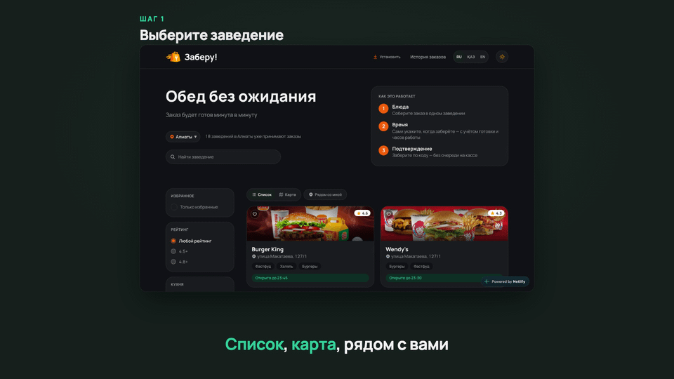
</p>

Каталог с поиском, умной сортировкой по открытости (закрытые заведения затемняются и опускаются в конец списка), фильтрами по кухне и рейтингу, избранным и картой. Кнопка «Рядом со мной» показывает только заведения в радиусе 1,5 км.

### 2. Соберите заказ

<p align="center">
  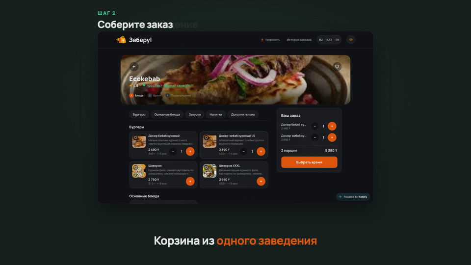
</p>

Меню разбито на категории, блюда можно добавлять в избранное. Корзина собирается из одного заведения: до 10 порций одного блюда, но не больше, чем помещается в слот.

### 3. Выберите минуту выдачи

<p align="center">
  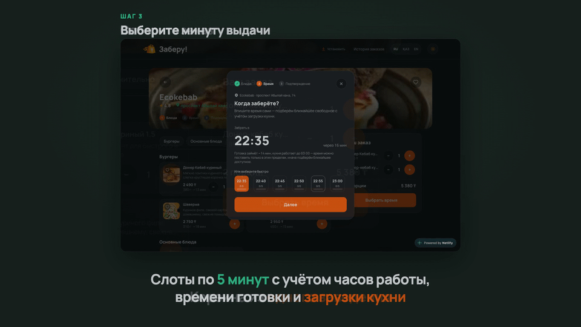
</p>

Слоты по 5 минут с учётом часов работы, времени приготовления и текущей загрузки кухни. Слот доступен, только если в него помещается весь заказ. Время также можно ввести вручную: приложение подберёт ближайший доступный слот.

### 4. Оплатите и получите номер

<p align="center">
  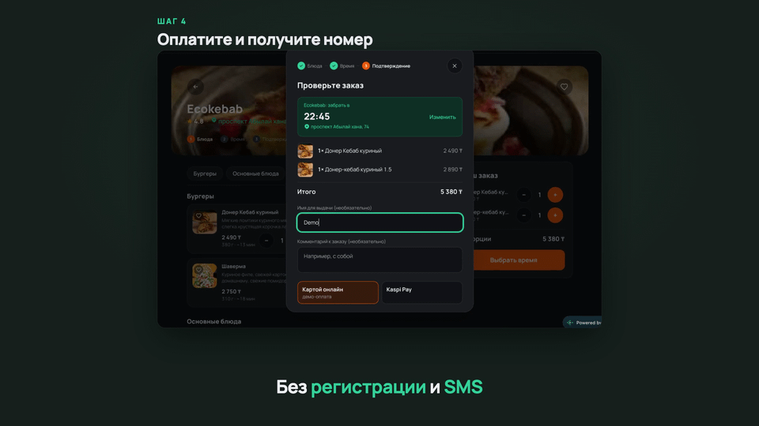
</p>

Имя и комментарий необязательны, оплата в демо-версии имитируется. Клиент получает номер заказа, например `N-001`: он последовательный в пределах заведения и дня и нужен для выдачи на кассе. Регистрация и SMS не нужны.

### 5. Кухня готовит ровно к этой минуте

<p align="center">
  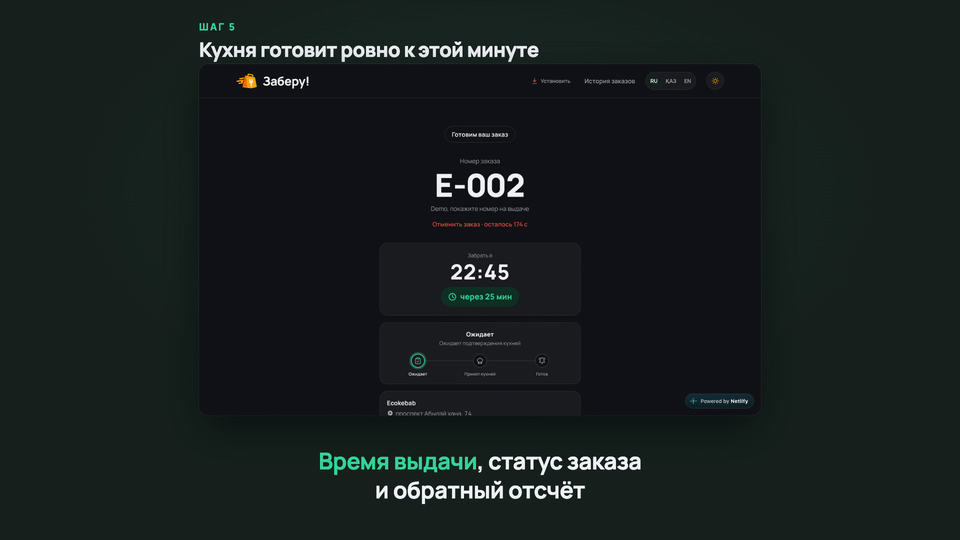
</p>

Сотрудник входит по email и паролю (Firebase Auth) и видит только свои заведения. Заказы лежат в трёх колонках: «Ожидают» → «Приняты кухней» → «Готовы». Есть метрики (выдано за последний час, пик загрузки ближайшего часа), график загрузки по 12 слотам, поиск по номеру, звук о новом заказе и отмена заказа с причиной.

<p align="center">
  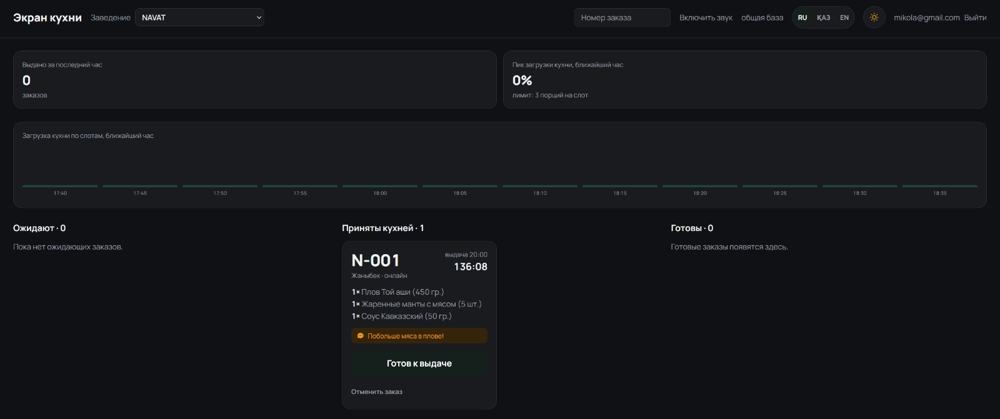<br/>
  <sub><b>Экран кухни.</b> Заказы по статусам и загрузка по слотам</sub>
</p>

### После оформления

Экран заказа показывает статус и обратный отсчёт. Кнопка «Я на месте» доступна за 15 минут до выдачи, отменить заказ можно в первые 3 минуты, получение клиент подтверждает сам. Если заказ готов, но его не забрали, он автоматически отменяется через 3 часа.

### На телефоне

<p align="center">
  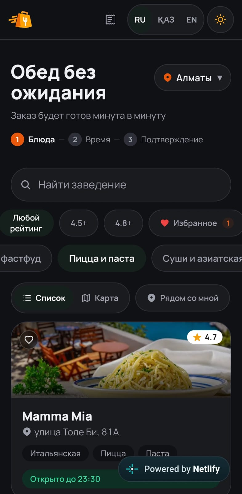
  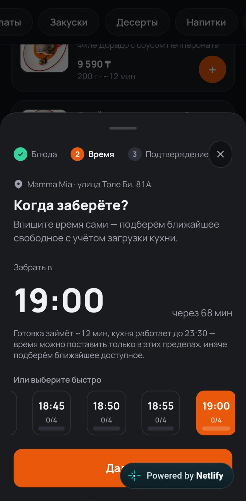
  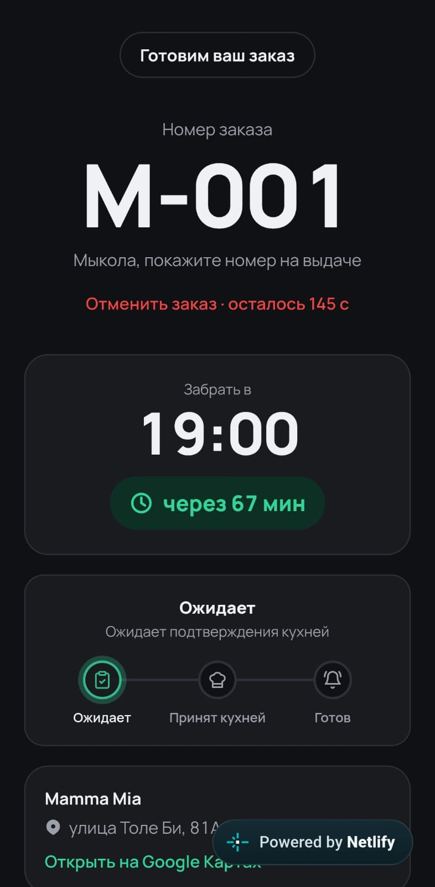<br/>
  <sub>Приложение адаптивное и устанавливается как PWA</sub>
</p>

## Быстрый старт: Онлайн-демо

Откройте [демо](https://zaberu-pwa-app.netlify.app/), выберите **NAVAT** (работает круглосуточно), добавьте блюдо, выберите ближайший слот и оплатите (демо-оплата): откроется экран заказа с номером. Онлайн-версия работает на Firebase, а экран кухни закрыт входом для сотрудников, как в реальном сервисе. Впрочем, доступ к [кухне](https://zaberu-pwa-app.netlify.app/staff) открывается следующими данными:

- Логин: ***mikola@gmail.com***
- Пароль: ***123456***

*Конкретно этот аккаунт даёт доступ к кухне сразу во всех заведениях. В реальном сценарии использования подразумевается, что аккаунт привязывается только к одному заведению.*

## История проекта

«Заберу!» родился на **FIZTEX Hackathon** (Алматы, 2026): мы командой собрали MVP и показали его на презентации. Участие подтверждено сертификатом Phys Tech School Almaty. Пока мы работали, я влюбился в этот проект, поэтому после презентации развивал его один и дальше.

При разработке MVP мы не использовали Git, а перебрасывали друг другу файлы в архиве, поэтому история коммитов в этом репозитории начинается с момента, когда я стал вести проект самостоятельно. Командный MVP лежит в первом коммите (`493e616`, «Исходный код»).

**Было (командный MVP):**

- заказ можно было оформить только локально в браузере
- около 2 300 строк мёртвого кода
- мелкие баги и критические ошибки, например, в логике времени, особенно ближе к полуночи

**Стало (последующие коммиты):**

- полноценное PWA с обновлённым понятным интерфейсом: умная сортировка по открытости заведений, карта, избранное, корзина, панель активных заказов, статусы заказа
- исправлена логика времени: ночные смены, отмены, защита слотов от двойной брони
- мёртвый код удалён, подключены ESLint и Prettier, наведён порядок в репозитории

## Инженерные решения

1. **Время готовности считается, а не угадывается.** Формула учитывает самое долгое блюдо и реальную вместимость конкретной кухни:

   ```text
   готовность = самое долгое блюдо + ceil(max(0, порции − 2) / вместимость слота) × 5 мин
   ```

   Первые две порции готовятся вместе с самой долгой. Слот доступен, только если в него помещается весь заказ. Логика вынесена в чистые функции без React и покрыта тестами: [`src/lib/time.js`](src/lib/time.js).

2. **Последнее место не достанется двоим.** В режиме Firestore оформление идёт в `runTransaction`: проверка `used + units > capacity` и создание заказа выполняются атомарно, а отмена освобождает слот в той же транзакции: [`src/lib/backends/firebase.js`](src/lib/backends/firebase.js).

3. **Два идентификатора заказа: один для ссылки, другой для кассы.** В Firestore документ получает случайный авто-ID (около 20 символов), он единственный ключ в ссылке `/order/{id}`. Список заказов читает только кухня своего заведения, поэтому чужой заказ нельзя ни перебрать, ни найти по номеру. Короткий код `N-001` нужен только для выдачи: он последовательный в пределах заведения и дня и сбрасывается каждые сутки.

4. **Ночные смены.** Заведение с графиком 12:00–02:00 в 01:00 считается открытым, потому что проверяется и сегодняшнее, и вчерашнее окно. Закрытое заведение сразу предлагает предзаказ на ближайшее открытие.

5. **Один фасад, два хранилища.** Экраны работают только с [`src/lib/api.js`](src/lib/api.js). Если задан `VITE_FIREBASE_PROJECT_ID`, данные идут в Firestore, иначе в `localStorage`. Благодаря этому проект запускается локально без какой-либо настройки, а вкладки браузера синхронизируются через `BroadcastChannel`.

6. **Безопасность без собственного сервера.** Всё держится на [`firestore.rules`](firestore.rules): сотрудник видит и меняет только заказы своих заведений, статусы нельзя откатить, нельзя подделать `readyAt` / `receivedAt` / поля отмены, за одну запись меняется не больше одного слота. Для правил написано 53 теста на эмуляторе (нужна Java 21+). Известные остаточные риски перечислены в разделе [«Честно о статусе»](#честно-о-статусе).

7. **Смена суток и лимиты Firestore.** Подписки пересоздаются при смене даты, чтобы кухня не «залипала» во вчера ([`src/lib/dayRollover.js`](src/lib/dayRollover.js)). Заказы кухни читаются четырьмя запросами вместо одного, потому что Firestore ограничивает оператор `in` 30 значениями, а два фильтра `in` перемножаются (18 заведений × 2 статуса = 36).

8. **Три языка под контролем тестов.** Русский, казахский и английский словари по 350 ключей. Тесты проверяют одинаковый набор ключей, отсутствие пустых строк и совпадение плейсхолдеров ([`tests/i18n.test.js`](tests/i18n.test.js)).

## Архитектура

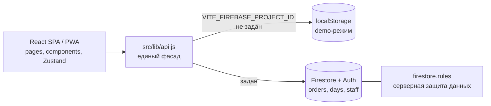

Собственного HTTP-сервера нет: браузер обращается к Firestore через SDK напрямую.

| | `localStorage` (demo) | Firestore |
|---|---|---|
| Данные | Один браузер | Все устройства проекта |
| Синхронизация | `BroadcastChannel` между вкладками | `onSnapshot` |
| Бронирование слота | Синхронная проверка и запись | Транзакция |
| Вход кухни | Не нужен | Email и пароль, документ `staff/{email}` |

**Жизненный цикл заказа**

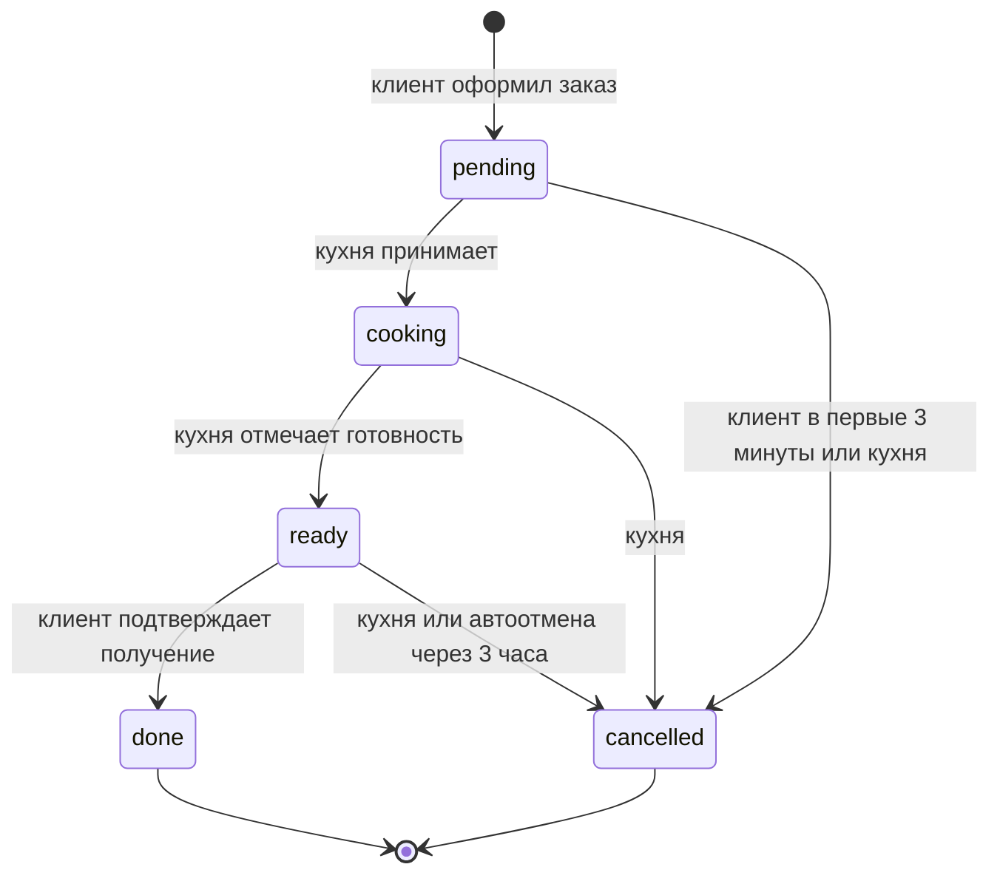

## Стек

| Область | Технологии |
|---|---|
| UI | React 18, React Router 6 (lazy-страницы), Tailwind CSS 3, Framer Motion, шрифт Manrope |
| Состояние | Zustand (корзина, избранное, язык; persist в `localStorage`) |
| Данные | Firebase 10: Firestore и Auth, либо `localStorage` |
| Карта | Leaflet, react-leaflet, OpenStreetMap |
| PWA | vite-plugin-pwa, Workbox (манифест, офлайн-кэш, установка) |
| Сборка и качество | Vite 5, ESLint, Prettier, `node --test` |

Язык: JavaScript (ESM). Требуется Node.js 18 или новее.

## Структура проекта

```text
Zaberu/
├─ src/
│  ├─ pages/        Home, RestaurantMenu, OrderTracking, MyOrders, AdminBoard
│  ├─ components/   корзина, шторки, карта, трекер заказа, скелетоны
│  ├─ lib/
│  │  ├─ backends/  local.js и firebase.js
│  │  ├─ i18n/      ru, kk, en
│  │  ├─ time.js    слоты, часы работы, расчёт готовности
│  │  └─ api.js     единый фасад над бэкендами
│  ├─ store/        корзина и избранное (Zustand)
│  └─ data/         каталог: 18 заведений, 486 блюд (JSON)
├─ public/          иконки и изображения блюд
├─ docs/            гифки и скриншоты для README
├─ tests/           unit-тесты и тесты правил Firestore
├─ firestore.rules  модель безопасности
└─ vite.config.js   React, PWA, Workbox
```

## Честно о статусе

Это прототип, и вот его границы:

| Область | Что есть на самом деле |
|---|---|
| Оплата | Имитация: пауза 0,9 с и создание заказа. Платёжного шлюза, возвратов и чеков нет. Выбор «Картой онлайн» / «Kaspi Pay» только интерфейсный |
| Уведомления | Работают через service worker, пока приложение открыто. Web Push не реализован: для него нужен сервер |
| Бэкенд | Собственного сервера нет. Цены и состав заказа формируются на клиенте, правила Firestore не сверяют их с меню |
| Доступ клиента | Регистрации нет: заказ открывается по прямой ссылке с непредсказуемым ID, а история «Мои заказы» хранится в браузере |
| Защита от злоупотреблений | Анонимное создание заказов не ограничено по частоте. App Check и капчи нет |
| Каталог | Статический JSON, полученный из публичных страниц «Яндекс Еды»: цены и наличие могут отличаться от актуальных. Админки меню нет, названия и описания блюд не переводятся |
| Тесты | Unit-тесты и тесты правил есть. UI/E2E-тестов и CI нет |
| Онлайн-демо | Работает на Firebase, экран кухни закрыт входом для сотрудников. Полный цикл с кухней запускается локально |
| Реальное использование | Пилотов в заведениях пока не было: для них нужны договорённости с заведениями, настоящая оплата и серверная часть |

## Планы

- Cloud Functions: серверная проверка цен и защита от злоупотреблений, Firebase App Check.
- Web Push, чтобы уведомление о готовности приходило и при закрытом приложении.
- Реальная оплата вместо имитации.
- Управление меню и сотрудниками из интерфейса.
- CI на GitHub Actions (тесты, линтер, сборка) и UI/E2E-тесты.
- Пилот в одном заведении.